<!--
  GitHub SEO — задайте в настройках репозитория (About):
  Description: Native macOS wallet for Solana: SwiftUI, self-custodial, Touch ID, Keychain, App Sandbox. Open source.
  Topics: solana, solana-wallet, crypto-wallet, macos, swiftui, swift, self-custody, keychain, touch-id, bip39, defi, desktop-app
-->

<div align="center">

# Solflare для macOS

### Нативный кошелёк Solana, созданный для Mac.
**Быстрый. Самохранимый. Встроенный в macOS.**

[](#системные-требования)
[](#отчёт-о-прозрачности-для-разработчиков)
[](#системные-требования)
[](#безопасность-превыше-всего)

<br>

**[⬇️ Скачать для macOS (.dmg)](https://github.com/Solflare-macos/solflare-wallet-macos/releases/latest)**
&nbsp;·&nbsp;
[Установка](#установка-за-две-минуты)
&nbsp;·&nbsp;
[Безопасность](#безопасность-превыше-всего)
&nbsp;·&nbsp;
[Для разработчиков](#отчёт-о-прозрачности-для-разработчиков)

<br>

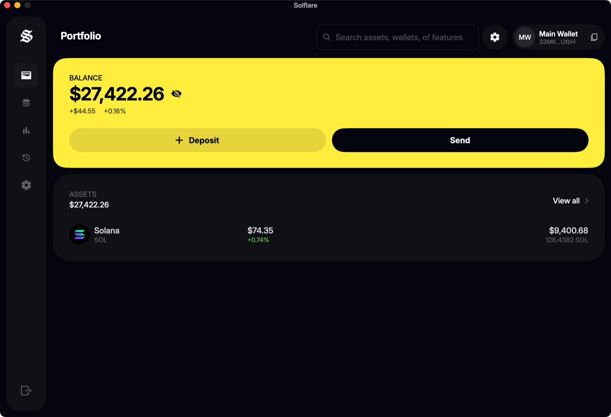

</div>

---

## Почему это приложение

Веб-кошельки живут во вкладке браузера, рядом с десятками расширений и скриптов. **Solflare для macOS** — отдельное приложение: один процесс, одно окно, ваши ключи за стеной системной изоляции.

| | |
|---|---|
| ⚡ **Нативная производительность** | Написано на SwiftUI без веб-движка и Electron: запускается за секунды, весит около 14 МБ, не нагружает батарею. |
| 🔐 **Повышенная безопасность** | Фраза восстановления хранится в Keychain macOS и открывается только по Touch ID или паролю Mac. Приватный ключ не записывается нигде. |
| 🍎 **Интеграция с macOS** | Touch ID, Keychain, App Sandbox, тёмная тема, горячие клавиши, автоматическая блокировка при сне и блокировке экрана. |

---

## Возможности

<p align="center">
  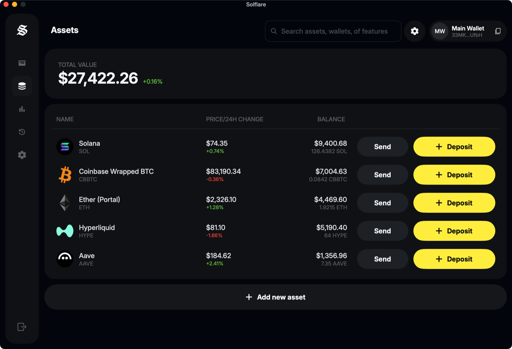<br>
  <sub>Assets: общая стоимость, цена и изменение за 24 часа, отправка и пополнение в одно нажатие</sub>
</p>

| Что вы получаете | Как это работает для вас |
|---|---|
| **Суверенитет самохранения** | Ваши ключи никогда не покидают ваш Mac: нет аккаунта, нет серверов проекта, нечего взламывать на стороне. |
| **Безопасность seed-фразы по отраслевому стандарту** | Фраза из 12 или 24 слов по стандарту BIP-39 — тот же формат и тот же путь вывода адреса, что у Solflare и Phantom. Импортируйте существующий кошелёк за минуту. |
| **Изоляция macOS (App Sandbox)** | Приложение работает в песочнице: оно не видит ваши документы, фото и другие программы, а наружу выходит только по сети. |
| **Отправка SOL и SPL-токенов** | Обзор перевода с комиссией, подтверждение Touch ID, статус в сети и ссылка на обозреватель. Для крупных сумм — дополнительный шаг проверки адреса. |
| **Рынки и портфель** | Баланс, изменение за 24 часа, рынки с фильтрами по капитализации, ликвидности и холдерам, сортировка по любой колонке, иконки токенов. |
| **История с подробностями** | Любая транзакция раскрывается в боковую панель: суммы, статус, полные адреса, комиссия, подпись. |
| **Свой RPC и тестовые сети** | Подключите собственный узел (Helius, QuickNode…) с проверкой кластера, переключайтесь между Mainnet, Devnet и Testnet. |
| **Адресная книга и белый список** | Сохраняйте получателей и разрешайте переводы только на проверенные адреса. |
| **Приватность** | Скрытие балансов одним переключателем и при каждом запуске, очистка локальных данных, диагностика без секретов. |

<table>
  <tr>
    <td width="50%" align="center">
      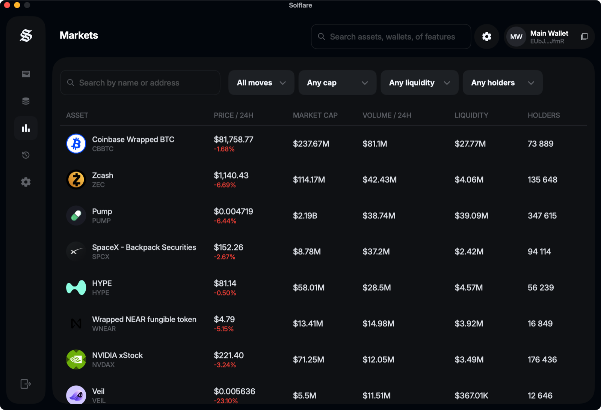<br>
      <sub><b>Markets</b>: сортировка по колонкам и фильтры</sub>
    </td>
    <td width="50%" align="center">
      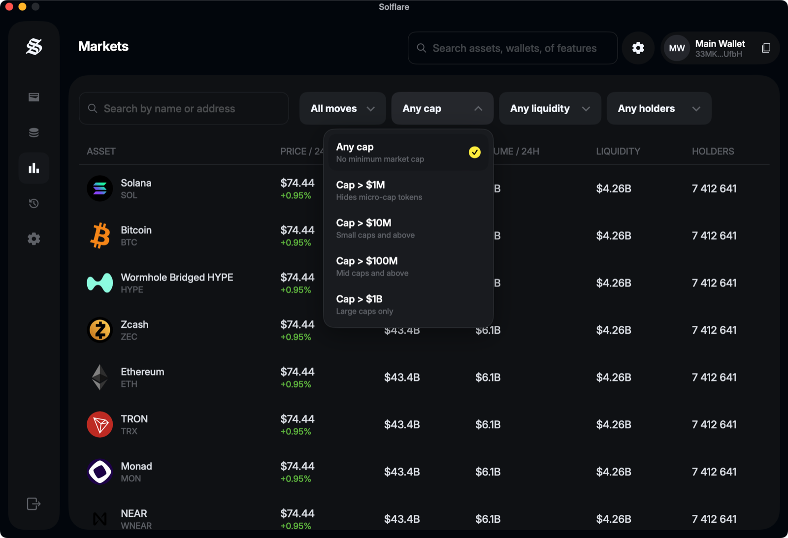<br>
      <sub><b>Фильтры</b> раскрываются плашкой с пояснениями</sub>
    </td>
  </tr>
  <tr>
    <td width="50%" align="center">
      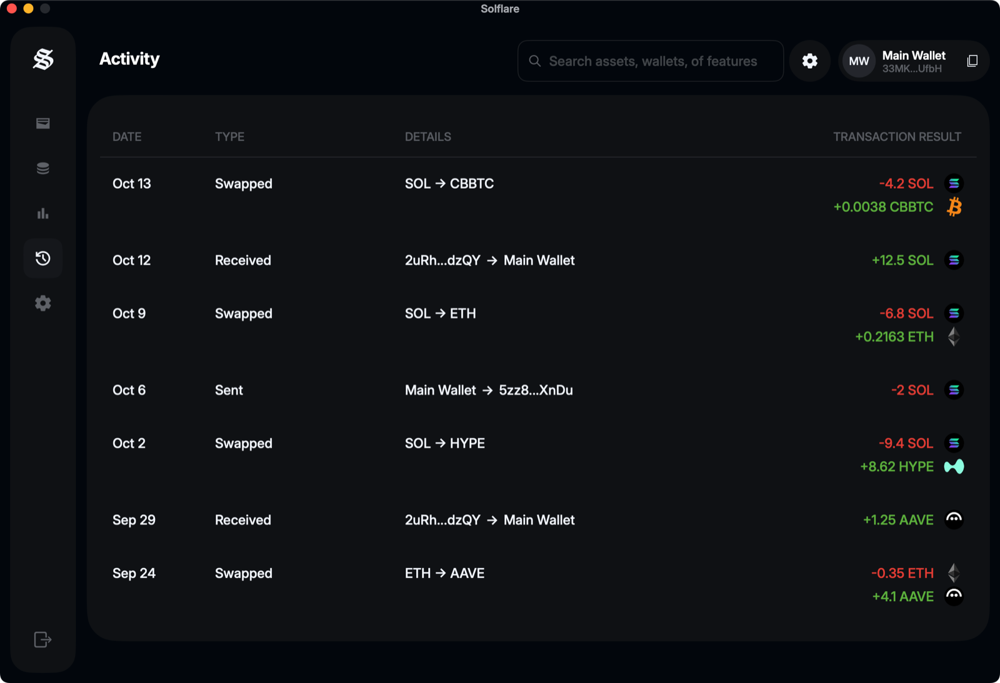<br>
      <sub><b>Activity</b>: вся история в одном списке</sub>
    </td>
    <td width="50%" align="center">
      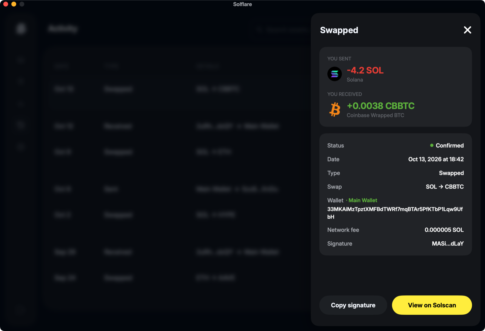<br>
      <sub><b>Транзакция</b>: суммы, статус, адреса, комиссия, подпись</sub>
    </td>
  </tr>
  <tr>
    <td width="50%" align="center">
      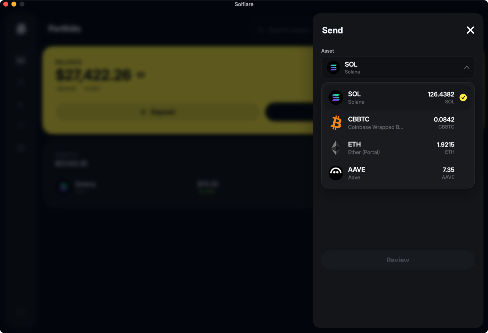<br>
      <sub><b>Send</b>: выбор актива с иконками и остатками</sub>
    </td>
    <td width="50%" align="center">
      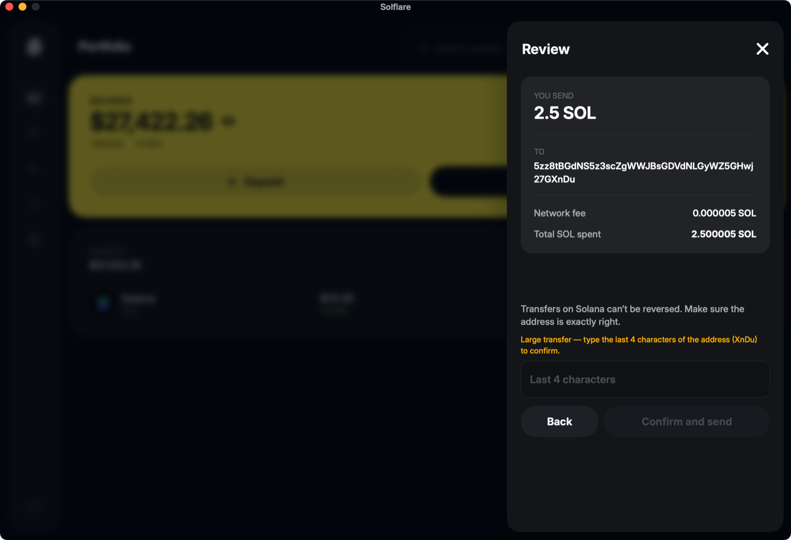<br>
      <sub><b>Review</b>: комиссия, полный адрес, повторный ввод для крупных сумм</sub>
    </td>
  </tr>
</table>

---

## Безопасность превыше всего

<table>
  <tr>
    <td width="50%" align="center">
      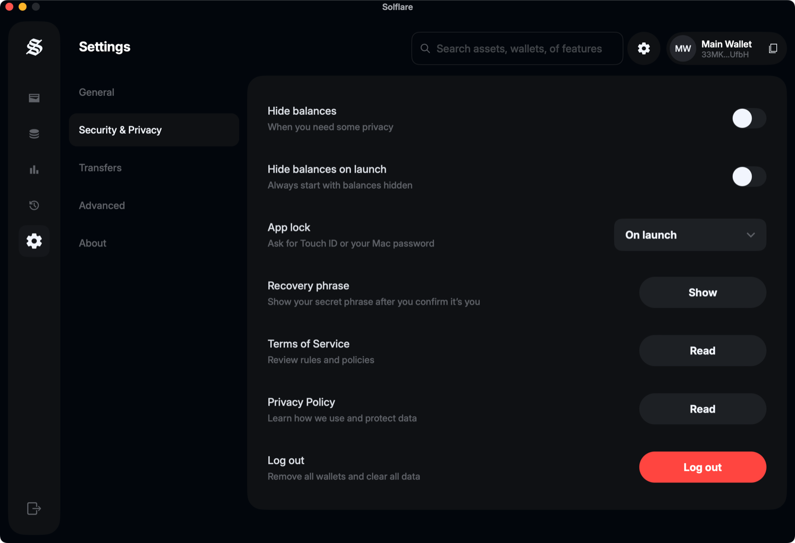<br>
      <sub><b>Security &amp; Privacy</b>: App lock, показ фразы, скрытие балансов</sub>
    </td>
    <td width="50%" align="center">
      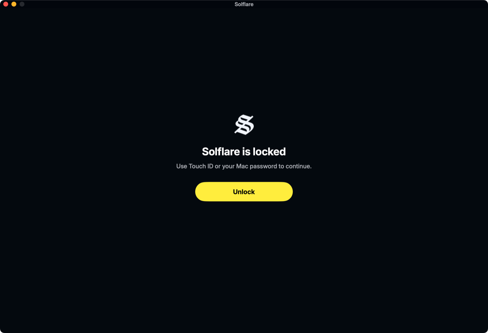<br>
      <sub><b>Блокировка</b>: Touch ID или пароль Mac</sub>
    </td>
  </tr>
</table>

Кошелёк — это не интерфейс, а **ответственность**. Поэтому безопасность здесь не опция, а архитектура.

### Self-Custodial по своей природе
Приложение не имеет серверной части. Фраза восстановления создаётся и хранится только на вашем устройстве. Разработчики физически не могут получить доступ к вашим средствам, а потеряв фразу, восстановить кошелёк нельзя — храните её офлайн.

### Шифрование Keychain
Фраза лежит в связке ключей macOS с доступом `ThisDeviceOnly`: не синхронизируется с iCloud и недоступна, пока Mac заблокирован. Приватный ключ **вообще не хранится** — он выводится из фразы на доли секунды в момент подписи и сразу уничтожается.

### Touch ID и пароль Mac
Системная проверка владельца (`LocalAuthentication`) требуется для:

- подписи и отправки перевода;
- показа фразы восстановления;
- смены защиты приложения;
- разблокировки после блокировки.

Touch ID необязателен: подтвердить действие можно паролем учётной записи.

### Блокировка и защита экрана
- **App lock**: при запуске или после 1 мин / 5 мин / 15 мин / 1 ч бездействия.
- Автоматическая блокировка при **сне Mac и блокировке экрана**, ручная — `⌘L`.
- Пока на экране фраза восстановления, окно **исключено из записи экрана**, а сама фраза скрывается через минуту.
- Копирование фразы в буфер обмена очищается автоматически.

### Защита от ошибок и подмен
Полный адрес получателя виден на обзоре перевода, крупные суммы требуют повторного ввода конца адреса, проверка состояния токен-аккаунта получателя предотвращает отправку «в никуда».

> **Честно о границах.** Блокировка приложения защищает интерфейс, но не заменяет защиту самой учётной записи macOS. Проект **не проходил независимый аудит безопасности**, а реальные транзакции в mainnet во время разработки не отправлялись. Первый перевод сделайте на минимальную сумму.

---

## Как это работает

```
Ваш Mac                                                       Сеть (чтение данных и отправка подписанных транзакций)
┌──────────────────────────────────────────────────────┐      ┌───────────────────────────┐
│  Интерфейс SwiftUI                                   │      │  Solana RPC               │
│        │                                             │      │  (публичный или ваш узел) │
│  AppModel — состояние и действия                     │      ├───────────────────────────┤
│        │                                             │ ───▶ │  Jupiter — токены, цены   │
│  WalletService ──▶ SolflareCore                      │      │  CoinGecko — курсы валют  │
│        │            BIP-39 · SLIP-0010 · Ed25519     │      └───────────────────────────┘
│  Keychain (фраза) ◀─ ключ живёт только в момент      │
│  Touch ID / пароль     подписи                       │      Приватные ключи и фраза
└──────────────────────────────────────────────────────┘      в сеть не отправляются
```

<p align="center">
  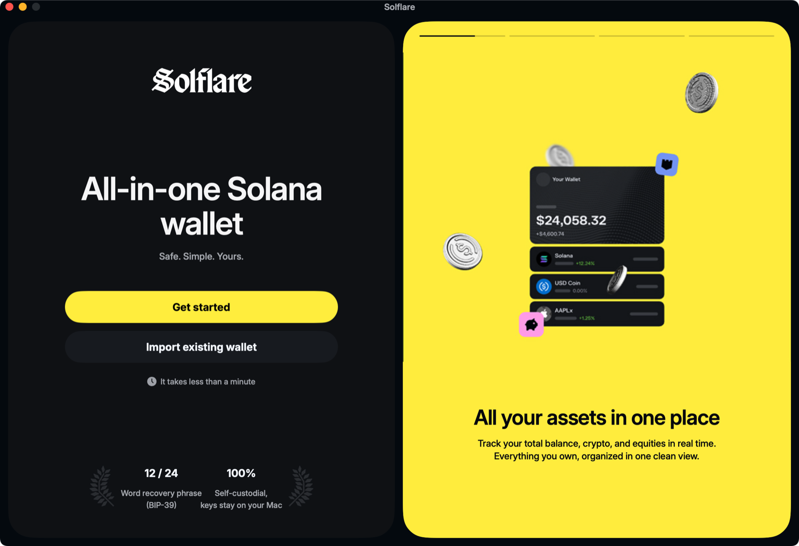<br>
  <sub>Первый запуск: создайте кошелёк или импортируйте существующий</sub>
</p>

1. **Создание или импорт.** Вы получаете 12 слов (или вводите свои). Приложение проверяет контрольную сумму и выводит адрес.
2. **Хранение.** Фраза записывается в Keychain, на диск открытым текстом не попадает.
3. **Работа.** Балансы, цены и история загружаются из открытых источников — по вашему публичному адресу.
4. **Подпись.** При переводе Touch ID подтверждает вас, ключ выводится на мгновение, транзакция подписывается локально и уходит в сеть уже подписанной.

---

## Установка за две минуты

### Системные требования

| Что | Минимум |
|---|---|
| macOS | **14.0 Sonoma** или новее |
| Mac | MacBook Air и Pro — 2018+, Mac mini — 2018+, iMac — 2019+, Mac Studio, Mac Pro 2019+ (Apple Silicon и Intel) |
| Экран | эффективное разрешение от 1440 × 900 (окно фиксированное 1200 × 820) |
| Сеть | интернет-подключение |

### Шаги

1. **Скачайте** `Solflare-macOS.dmg` со страницы [Releases](https://github.com/Solflare-macos/solflare-wallet-macos/releases/latest).
2. **Проверьте контрольную сумму** — это занимает десять секунд и подтверждает, что файл не изменён:
   ```bash
   shasum -a 256 ~/Downloads/Solflare-macOS.dmg
   ```
   Результат должен совпасть со значением `SHA-256` в описании релиза.
3. **Откройте** `.dmg` и перетащите **Solflare** в папку **Программы**.
4. **Первый запуск** — см. ниже.

### Первый запуск: подтверждение macOS

macOS по умолчанию допускает только программы, заверенные Apple. Сборки из GitHub такой нотариальной проверки не проходят, поэтому система показывает предупреждение о приложении **от неидентифицированного разработчика**. Это штатная защита экосистемы Apple, а не признак проблемы с файлом — если контрольная сумма совпала.

Профессиональный способ открыть приложение, не снижая защиту системы:

1. В Finder откройте **Программы**, нажмите на **Solflare** правой кнопкой (или `Control` + клик) → **Открыть**.
2. В появившемся окне ещё раз нажмите **Открыть**. Дальше приложение запускается как обычно.
3. Если пункт «Открыть» недоступен: **Системные настройки → Конфиденциальность и безопасность** → прокрутите вниз до сообщения о Solflare → **Всё равно открыть**.

> **Не отключайте Gatekeeper целиком** и не выполняйте команды, снимающие защиту со всей системы. Для кошелька это лишний риск.

---

## Отчёт о прозрачности для разработчиков

Этот проект — открытый код, и всё, что описано выше, можно проверить.

### Устройство проекта

```
SolflareMac/
├── Solflare/                    приложение (SwiftUI)
│   ├── App/                     точка входа, окно, роутер, состояние
│   ├── Features/                экраны: онбординг, Portfolio, Assets, Markets, Activity, Settings, модальные окна
│   ├── Services/                кошелёк, Keychain, сеть, кэши, Touch ID
│   ├── DesignSystem/            палитра, шрифты, компоненты, плашки выбора
│   └── Domain/                  модели и форматирование
├── Packages/SolflareCore/       криптография, RPC, сборка и подпись транзакций (без UI) + тесты
└── Tools/                       генерация иконок, независимый эталон для тестов
```

### Факты

| Вопрос | Ответ |
|---|---|
| Где хранится фраза? | Только в Keychain (`ThisDeviceOnly`). Файлов и логов с фразой нет. |
| Где хранится приватный ключ? | Нигде: выводится на время подписи (`SolanaSigner`) и не сохраняется. |
| Как выводится адрес? | BIP-39 → PBKDF2-HMAC-SHA512 → SLIP-0010 ed25519, путь `m/44'/501'/0'/0'`. |
| Что уходит в сеть? | Публичный адрес, запросы цен и подписанные транзакции. Фраза и ключи — никогда. |
| Зависимости? | Нет сторонних библиотек: CryptoKit, CommonCrypto, Security, LocalAuthentication. |
| Тесты? | 70 тестов ядра: официальные векторы BIP-39/SLIP-0010, независимый эталон на Python, побайтное сравнение с реальными транзакциями mainnet. |
| Песочница? | App Sandbox, права: только исходящая сеть. |

### Известные ограничения

- Независимого аудита безопасности не было.
- Реальные переводы в mainnet при разработке не отправлялись (использовались симуляция и сравнение с эталоном) — начните с минимальной суммы.
- Токены Token-2022 показываются, но отправка пока не поддерживается; приоритетных комиссий и memo нет.
- Один аккаунт кошелька (`m/44'/501'/0'/0'`).
- Публичный RPC ограничивает частоту запросов: холодная загрузка истории занимает до ~20 секунд — свой узел снимает ограничение.

### Документация

- [`docs/TECHNICAL.md`](docs/TECHNICAL.md) — полное описание: экраны, авторизация по seed-фразе, управление приложением, таблица файлов.
- [`PLAN.md`](PLAN.md) — план, этапы, ограничения, чек-лист приёмки.

> **Статус проекта.** Независимая нативная реализация интерфейса Solflare для macOS. Если иное не указано владельцем репозитория, проект не является официальным продуктом команды Solflare.

---

<div align="center">

## Готовы попробовать?

# [⬇️ Скачать Solflare для macOS](https://github.com/Solflare-macos/solflare-wallet-macos/releases/latest)

**`.dmg` · macOS 14+ · Apple Silicon и Intel · около 14 МБ**

Ваши ключи. Ваш Mac. Ваш контроль.

<sub>Криптовалюты связаны с риском потери средств. Храните фразу восстановления офлайн и никому её не передавайте.</sub>

</div>
